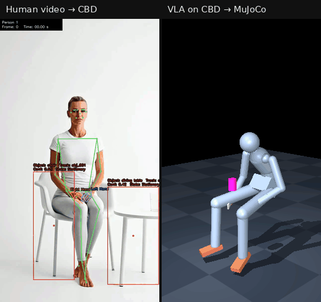
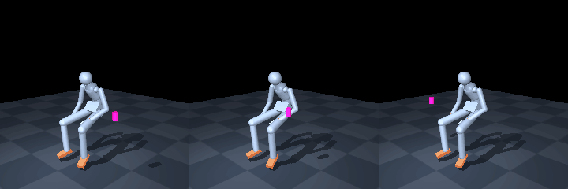
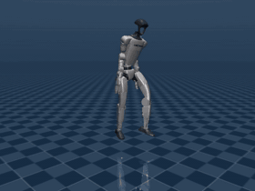
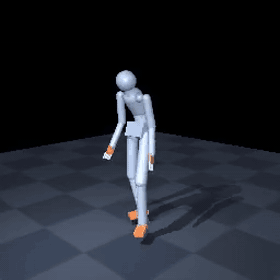

<div align="center">

# vla-maker-from-cbd

**人の動きのデータ（CBD）から、ヒューマノイドを動かす AI（VLA）を作る。**

[English](README.md) · [結果（詳細）](docs/results.ja.md) · [参加の仕方](CONTRIBUTING.ja.md) · [Common Behavior Data](https://github.com/Koichi3333/common-behavior-data)



*左: ふつうの動画を、体の動きのデータ（CBD）にしたところ。<br>
右: CBD で学習した VLA に「座ってテーブルのグラスを取り、飲んで、戻す」と指示したところ。グラス（マゼンタ）に手を伸ばし、口元まで運ぶ。*

<sub>左は [Common Behavior Data](https://github.com/Koichi3333/common-behavior-data) のサンプルで、この人物は学習データに入っていない。
右は MuJoCo の運動学のシミュレーション（姿勢を並べて再生するだけで、力は計算していない）。指は無く、手が届くとグラスが手に付く。
グラスに届くまでは外から手の通り道を示しているが（誘導）、口元へ運ぶ動きはモデル自身が出したもの。
この場面の 12 回の試行のうちの 1 回で、残りの 11 回はグラスがあごの高さより下で止まった。
動きの細かいカクつきは [`vla/smooth_motion.py`](vla/smooth_motion.py) で後から均している。</sub>

</div>

---

**VLA**（Vision-Language-Action）は、カメラの画像と指示文を受け取り、体の動きを出す AI のモデルです。
このリポジトリは、その学習データを **Common Behavior Data（CBD）** から作ります。CBD は、人の動作を骨の回転として記録する
オープンな形式で、人・ロボット・アバターといった特定の体に依存しません。

全体は 3 段の流れです。

1. **人の動画や mocap を CBD にする**（[common-behavior-data](https://github.com/Koichi3333/common-behavior-data) の生成器）
2. **CBD を学習データにして、NVIDIA GR00T N1.7 を追加学習する**（このリポジトリ）
3. **モデルが出した動きを CBD に戻し、ロボットやアバターに載せ替える**（CBD のアダプタ）

モデルが出す動きは、ロボットの関節の角度ではなく、**CBD の骨の回転そのもの**です（19 本の骨と腰の位置で、1 フレーム 117 個の数）。
そのため、MuJoCo の人型・Unitree G1・VRM のアバターのどれに載せるときも、**体ごとに学習し直す必要がありません**。

> **状態: 研究段階のプレビュー。一緒に進める人を探しています。** 最初から最後まで一通り動き、下の数字はすべて実測です。
> 難しい問題がいくつか残っていて、[下に](#手伝ってほしいこと)あえてそのまま並べています。

## 手伝ってほしいこと

今のところ 1 人で進めているプロジェクトです。次のどれかを引き受けてもらえると、大きく前に進みます。
どれも単独で取りかかれる大きさです。Issue にコメントするか、新しく立てて宣言してください。
進め方は [CONTRIBUTING.ja.md](CONTRIBUTING.ja.md) にあります。

| | 課題 | なぜ大事か | GPU |
| --- | --- | --- | --- |
| 🔴 | [#1](https://github.com/Koichi3333/vla-maker-from-cbd/issues/1) **VLA が自力で物まで手を届かせるようにする。** 今、手が物まで正確に届くのは、動かすときに外から手の通り道を示している（推論時の誘導）おかげ。誘導を外しても物のある方へ手を向けることはできるが、物まで届く割合は 0.93 → 0.51 と約半分に下がる | 外からの手助けなしで動く、本当の意味の VLA になる | 要る（A100、1 回 約 30 CU） |
| 🔴 | [#2](https://github.com/Koichi3333/vla-maker-from-cbd/issues/2) **物を扱う場面を撮影して、CBD として提供する。** 固定カメラで、座って・立って物を扱う様子を撮り、CBD の動画生成器で変換する | 一番足りないのはデータ。自分が権利を持つデータだけが、商用にも使えるモデルにつながる | 要らない |
| 🟠 | [#3](https://github.com/Koichi3333/vla-maker-from-cbd/issues/3) **動画の動きの予測で「今の姿勢を保つだけ」に勝つ（H-3）。** 動画から作った clip の続きを予測させると、今の最良は誤差 5.53° で、何もせず今の姿勢を保った場合の 5.05° にまだ負けている | 人の動きを本当に予測できているかの、ごまかしの利かない試験 | 要る（約 1 CU） |
| 🟠 | [#4](https://github.com/Koichi3333/vla-maker-from-cbd/issues/4) **Colab 以外の GPU で動かす。** `colab/vm_*.sh` を、手元の GPU・RunPod・Lambda・Modal などへ移す | 今は毎回、Google Drive をつなぐためにブラウザでの同意が要る | 各自 |
| 🟡 | [#5](https://github.com/Koichi3333/vla-maker-from-cbd/issues/5) **物理シミュレーションで確かめる。** 生成した G1 の動きを、接触や重力を計算するシミュレータ（Isaac、接触ありの MuJoCo）で再生し、何が崩れるかを報告する | ここまではすべて運動学（姿勢を並べるだけで、力は計算していない） | どちらでも |
| 🟡 | [#6](https://github.com/Koichi3333/vla-maker-from-cbd/issues/6) **指を足す。** CBD にはまだ指の骨が無く、「持つ」は手が物に近いかどうかの判定 | 本当に掴むには指が要る | 要らない |
| 🟢 | [#7](https://github.com/Koichi3333/vla-maker-from-cbd/issues/7) **ログを英訳する。** コードのコメントは英語にしたが、画面に出すメッセージやコマンドのヘルプの多くがまだ日本語 | ほかの人が入りやすくなる | 要らない |
| 🟢 | [#8](https://github.com/Koichi3333/vla-maker-from-cbd/issues/8) **CPU の通しテストを CI（自動テスト）に載せる**、パッケージ化、型ヒント | 手順が知らないうちに壊れるのを防ぐ | 要らない |

初めての方は、まず [CPU の通しテスト](#1-cpu-の通しテストgpu-も重みも要らない) を回し、🟢 から選んでください。

## 全体のつながり

```
 自分の動画 ─┐                           （common-behavior-data）
 mocap ──────┼──► CBD の clip ───────────────────────────────────────────┐
             │    ボーン回転 19 本・腰・物・キャプション                  │
             │                                                           ▼
             │    vla/cbd_to_lerobot.py・vla/video_to_lerobot.py     CBD のアダプタ
             │      117 次元の state / action（6D の回転）＋ 指示文   MuJoCo・Isaac G1・VRM
             │    vla/humanml3d_to_video.py・render_with_objects.py        ▲
             │      体（と物の代理形状）を MuJoCo で 256px に描く          │
             ▼                                                           │
      LeRobot データ ──► GR00T N1.7 の追加学習（action head）──► 117 次元の行動
                                     ▲                                   │
              目標 ─► 計画器 ─► 推論時の誘導（vla/groot_guidance.py）      vla/state_to_cbd.py
              ▲
   VLM が同じ画面で物を指す（vla/vlm_target.py・vla/vlm_goal_depth.py）
```

- **モデルが出すのはロボットの動きではなく、CBD の骨格の動き。** ロボットへの載せ替えは、モデルの後ろで CBD のアダプタが行う。
  ロボットを替えても、データの集め直しも学習のし直しも要らない。
- **モデルが見るのは元の動画ではなく、描き直した画面。** 同じ姿勢をとらせた MuJoCo の無個性な体と、物の簡単な代理形状（円柱や箱）を描いたもの。
  人の顔や部屋は学習データに入らない。
- **物を選ぶのは VLM、体を動かすのは VLA。** VLM（画像を読める言語モデル。ここでは Gemini Robotics-ER）が、画面の中で指示された物を指す。
  その点を 3D の目標にして計画器が手の通り道を引き、VLA が動きを作る途中で腕をその通り道へ寄せる（推論時の誘導）。

## いまできること

**ひとことで: 誘導ありなら、物をどこに置いても 9 割前後で手が物まで届く。誘導なし（モデル単体）では、物の方へ手を向けることはできるが、届くのは約半分。**

学習に使っていない 7 場面で、物の位置を 3 通り（元の位置 / 25 cm ずらす / 体の反対側）に変え、それぞれ 4 回ずつ動かした結果です。
MuJoCo の運動学のシミュレーションで測りました。

| | 誘導あり・目標は正解の位置 | 誘導あり・目標は VLM が選んだ位置 | 誘導なし（モデル単体） | 合格の基準 |
| --- | ---: | ---: | ---: | ---: |
| 手が物から 10 cm 以内に来た割合: 元 / ずらし / 反対側 | 1.00 / 1.00 / 0.89 | **1.00 / 1.00 / 0.89** | 0.86 / 0.86 / 0.61 | |
| 手が、描いた物の方へ近づいた割合: ずらし / 反対側 | 1.00 / 1.00 | 1.00 / 1.00 | 0.96 / 0.71 | ≥ 0.7 |
| 手が物に届いた割合（「持てた」） | 0.94 | 0.93 | 0.51 | |
| 物を動かすと、手の行き先も付いていくか（H-4 の傾き。1 に近いほど物にぴったり付いていく） | +0.613 | – | +0.577 | ≥ 0.5 |
| 元の動き（HumanML3D）の予測の誤差。動画を混ぜても悪くならないか（H-1。小さいほど良い） | 9.55° | 同じ重み | 9.32° | ≤ 9.65° |

<sub>「誘導あり」は、`checkpoint-47000` に arm H の action head を載せ、誘導の強さ fk 0.3 で動かしたもの。このリポジトリではこれを「使える形」と呼んでいる。
「誘導なし」は arm J（30,000 ステップ学習した action head）を誘導なしで動かしたもの。</sub>

- VLM は **378 問すべて**で、指示された物を正しく選んだ（よく似た別の物を置いた場面も含む）。
- 動画から作った CBD を学習データの約半分まで混ぜても、元の動きの予測は**悪くならなかった**（H-1）。
- 生成した歩く動きは、CBD のアダプタでそのまま Unitree G1 に載った。向きのずれ（中央値）は、お手本にした動きより小さい（0.96° 対 1.54°）。

**まだ言えないこと:**

- 物理シミュレーションや実機で成功すること（ここまではすべて運動学）
- 指で掴むこと（「持てた」は、手が届く距離に来たら物を手に付ける判定）
- 誘導なしの VLA 単体で、物まで正確に届くこと
- 動画の続きの予測で、「今の姿勢を保つだけ」に勝つこと（H-3）

数字の全部は [docs/results.ja.md](docs/results.ja.md)（英語の要約は [docs/results.md](docs/results.md)）にあります。



*指示も最初の姿勢も同じまま、グラス（マゼンタ）の位置だけを 3 通りに変えた。手はそのたびにグラスのある方へ向かい、届いた後はグラスが手と一緒に動く。*

<sub>MuJoCo の運動学のシミュレーション。手を伸ばす目標は VLM が画像から選んだ点（図には描いていない）で、誘導ありで動かしている。
冒頭と同じく [`vla/smooth_motion.py`](vla/smooth_motion.py) で後から均している。</sub>

 

*左: 「a person walks forward」（前へ歩く）と指示して生成した動きを、G1 に載せたもの（運動学）。右: 「a person crawls on the floor」（床を這う）。<br>
右の文は学習データに無く、這う動きの clip も学習データに 16 本しかない。*

## はじめかた

### 1. CPU の通しテスト（GPU も重みも要らない）

本物のモデルの代わりに「今の姿勢を保つだけ」の偽物を差し込み、誘導・評価・物を手に付ける処理・動画の書き出しが一通り動くかを確かめます。
ノート PC で数分です。

描画には OSMesa（ソフトウェアの OpenGL）を使うので、先に入れておきます（Debian / Ubuntu なら `sudo apt-get install libosmesa6`）。

```bash
pip install -r requirements.txt
MUJOCO_GL=osmesa python3 tests/smoke_test.py head          # 誘導で手が計画の経路に乗る（17.8 cm → 0）
MUJOCO_GL=osmesa python3 tests/smoke_test.py rollout       # 2 場面 × 60 フレーム。mp4 と軌跡を work/smoke/ へ
MUJOCO_GL=osmesa python3 tests/smoke_test.py rollout vlm   # 目標を VLM の点にして同じことをする
```

### 2. 使える形を Colab で動かす

要るものは次の 4 つです。

- A100 が使える Colab の契約
- [`google-colab-cli`](https://github.com/googlecolab/google-colab-cli)（`jupyter-kernel-client<1.0` に固定する）
- `nvidia/GR00T-N1.7-3B` を取れる Hugging Face のトークン
- Google Drive に置いた重み（[重み](#重み)）

```bash
bash colab/start.sh infer myrun        # A100 のセッションを作り、コードを送り、Drive の同意 URL で止まる
# /tmp/dm_url.txt の URL を開いて同意
bash colab/go.sh infer myrun           # 目標ファイル 1 本で約 20 分・約 1.4 CU
colab download -s myrun /content/run/results.tgz work/myrun/results.tgz
colab stop -s myrun                    # 必ず止める
```

Colab の落とし穴は [docs/colab.md](docs/colab.md) にまとめました。主なものは 3 つです。トークンは 60 分で切れる、通信が無いと約 25 分で
GPU の割り当てが消える、Drive へのコピーはアップロードの完了を待たずに終わったことになる。スクリプトはどれにも対処してあり、文書にはその理由を書いています。

### 3. 続きの学習

arm H（使える形の action head）を作ったときの手順です。`checkpoint-47000` から始め、HumanML3D（mocap の動きのデータ）に物つきの CBD を
混ぜて（`DUP=40` でフレームの約 50%）、action head（動きを出す部分）を学習します。

```bash
bash colab/start.sh train t1                           # 自分の clip を使うなら VIDEO_DATA=<LeRobot データ>
STEPS=5000 DUP=40 RUN=t1 bash colab/go.sh train t1     # 約 1.5 時間・約 9 CU。重みは Drive の runs/t1/ に
ACTION_HEAD=runs/t1/action_head.safetensors bash colab/go.sh infer ...   # 学習した head を使える形で評価
```

### 4. 自分の CBD を持ち込む

1. clip を撮り、[common-behavior-data](https://github.com/Koichi3333/common-behavior-data) の動画生成器で CBD にする。
2. `python3 vla/video_to_lerobot.py --cbd-dir <CBD のディレクトリ> --out work/my_video` を実行する。117 次元の LeRobot データと、フレームごとの物の状態が書かれる。
3. `VIDEO_DATA=work/my_video bash colab/start.sh train ...` で学習する。

mocap など、ほかの出所の CBD も同じように `vla/cbd_to_lerobot.py` を通せます。

## ファイルの配置

| 場所 | 中身 |
| --- | --- |
| `vla/` | 動くものすべて。CBD ↔ LeRobot の変換、描画、GR00T の modality config、評価、誘導、VLM の目標 |
| `colab/` | `start.sh` / `go.sh`（Codespace 側）、`vm_train.sh` / `vm_infer.sh` / `vm_data.sh`（VM 側）、`watch.sh`、`autostop.sh` |
| `data/video_reach/` | 物つきの学習データ。実写 13 本（作者の動画）＋ 誘導して作った合成 658 本（うち 11 本は評価用に取り分け）、計 671 本。画像は含まない |
| `data/eval/` | 評価の仕様。評価用の 7 場面・学習側の 7 場面・VLM が選んだ目標 |
| `data/stats/` | `checkpoint-47000` の正規化の統計（誘導と通しテストが使う） |
| `tools/` | Colab の補助（CU 残高・セッションの付け直し・Secret・pty の包み）・Hugging Face のメタデータ・README の GIF |
| `tests/smoke_test.py` | 上の CPU の通しテスト |
| `hf/README.md` | Hugging Face のリポジトリのモデルカード |
| `docs/` | 結果・学習データと規約（`data.ja.md`）・Colab の運用・メディア |

## 重み

使える形は 2 つの重みでできています。どちらも GR00T N1.7（3B パラメータ）を元にしたものです。

- `checkpoint-47000`: 追加学習したチェックポイント全体。optimizer の状態を除いて約 12 GB。
- `action_head_bf16_v12e_armH.safetensors`: arm H の action head。3.2 GB。

Hugging Face の **[Koichi3333/vla-maker-from-cbd](https://huggingface.co/Koichi3333/vla-maker-from-cbd)** で公開しています。
取るには、Hugging Face にログインして、下の利用条件（非商用の研究・評価に限る）に同意する必要があります（gated）。

Colab のスクリプトは、今はまだ Google Drive の `MyDrive/VLA/VLA_1_0/` から重みを読みます
（`ckpt/checkpoint-47000/`、`v12e/…armH.safetensors`、`data/b3_dataset.tar`。置き場所は `DRIVE=` で変えられる）。
Hugging Face から読むように切り替える予定です。

- Drive から Hugging Face へ上げ直す: `colab/hf_upload.sh`（モデルカードは `hf/README.md`）
- 学習用の描画データ `b3_dataset.tar` を作り直す: `colab/go.sh data`。元になる HumanML3D は、各自が AMASS から作る（[docs/data.ja.md](docs/data.ja.md)）

## ライセンス

**ひとことで: コードは自由に使えます（Apache-2.0）。重みと学習データは非商用（研究・評価）に限ります。**

- **このリポジトリのコード**: Apache License 2.0（[LICENSE](LICENSE)）。
- **`docs/media/hero_video_to_vla.gif` の左半分**: Common Behavior Data のサンプル動画に由来し、このリポジトリのライセンスの対象外。
  条件は同リポジトリの [THIRD_PARTY_NOTICES.md](https://github.com/Koichi3333/common-behavior-data/blob/main/THIRD_PARTY_NOTICES.md) に従う。
- **GR00T N1.7 とそれを元にした重み**: GR00T N1.7 は、モデルカードでは **NVIDIA Open Model License** だが、同梱の `LICENSE` は
  非商用の **NVIDIA License** になっている。重みは両方を満たすよう、非商用（研究・評価）に限って配布する。条件はモデルのリポジトリの `NOTICE`
  （元は [`hf/NOTICE`](hf/NOTICE)）。**Built on NVIDIA Cosmos**: 画像と言語を読む部分（backbone）は Cosmos-Reason2-2B。
- **学習データ**: HumanML3D / AMASS と SMPL（動画の胴の当てはめに使用）は**非商用の研究用**。これらで学習した重みと
  `data/video_reach/` も同じ扱い。非商用の研究のための学習は認められているが、AMASS 由来の動きのデータは再配布できないので、
  各自が AMASS から直接入手する。商用に使うには、自分が権利を持つデータが要る。提供してもらう CBD の clip が大事なのはこのため。
  詳しくは [docs/data.ja.md](docs/data.ja.md) と [data/README.md](data/README.md)。

## 引用

この成果を使うときは、土台にした **AMASS**・**SMPL**・**HumanML3D**・**HumanAct12**・**GR00T N1** も引用してください。
AMASS と SMPL は、使った出版物で論文を引用することを規約で求めています。BibTeX は [docs/data.md](docs/data.md#citations)。

## 謝辞

NVIDIA Isaac GR00T（Built on NVIDIA Cosmos）・HumanML3D・AMASS・SMPL・MuJoCo・LeRobot・SAM 2・MediaPipe・ROMP・Gemini Robotics-ER。
