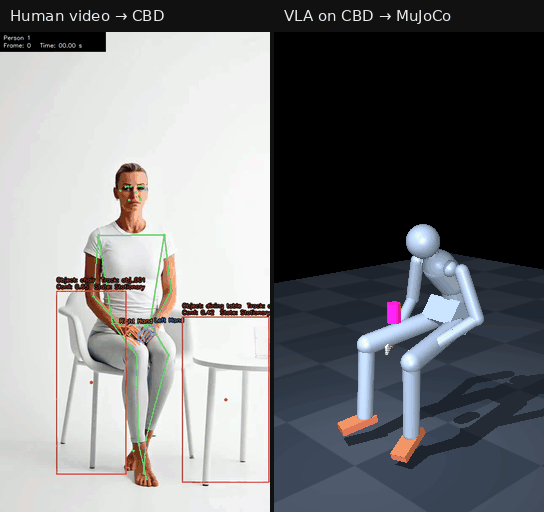
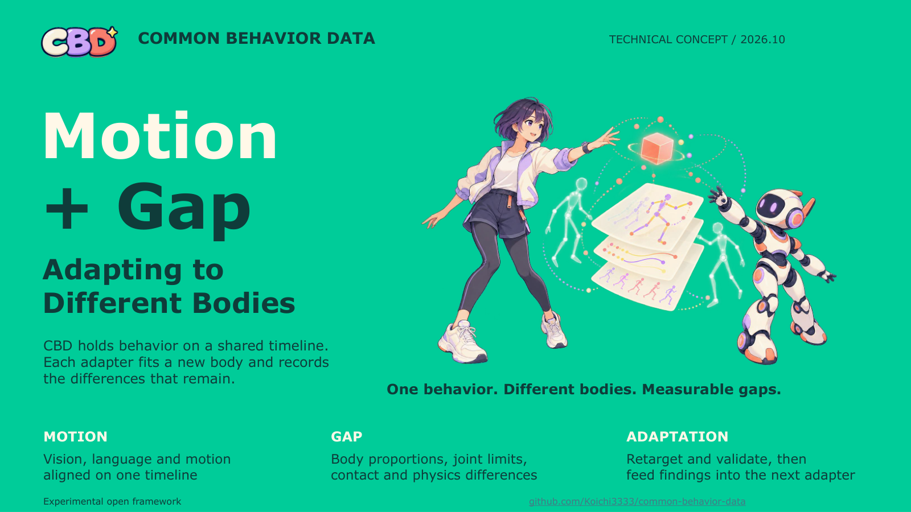

# vla-maker-from-cbd: synthetic reaching clips (CBD, LeRobot format)



*Left: an ordinary video turned into body-motion data (CBD); a sample from Common Behavior Data, not in the training
data. Right: the VLA trained on this dataset and more, told "a seated person picks up a glass from the table, drinks
from it, and puts it back". Kinematic MuJoCo (no forces), no fingers. Until the hand reaches the glass an outside
planner guides it; the lift to the mouth comes from the model. One of 12 trials of this scene; in the other 11 the
glass stops at chin height or below. The clips in this dataset themselves are shorter: reaching, then about 1 s held.*

**647 episodes, 35,128 frames, 20 fps.** Short reaching and object-handling motions of a humanoid, as CBD bone rotations in
the LeRobot v2.0 layout. They are part of the data used to train the model in
[Koichi3333/vla-maker-from-cbd](https://huggingface.co/Koichi3333/vla-maker-from-cbd). We cannot claim
that the model reaches objects precisely without inference-time guidance.

**CBD** ([Common Behavior Data](https://github.com/Koichi3333/common-behavior-data)) is an open format that records
human motion as bone rotations (19 bones plus the hip position), independent of any particular body. The same episode
can be put on a MuJoCo humanoid, a Unitree G1 or a VRM avatar without retraining for each body. Code, training and
evaluation: [GitHub](https://github.com/Koichi3333/vla-maker-from-cbd).

<a href="https://github.com/Koichi3333/common-behavior-data/blob/main/docs/media/CBD_Technical_Concept_Deck.pdf"></a>

*The CBD concept in one page ([PDF](https://github.com/Koichi3333/common-behavior-data/blob/main/docs/media/CBD_Technical_Concept_Deck.pdf)).*

> **Non-commercial research or evaluation use only.** Gated: you agree to this when you request access.

## What is, and is not, in here

- **Model-generated, not measured.** Every episode is a closed-loop rollout of an earlier model (arm B) with inference-time
  guidance, cut to the reaching segment. No recording of a person is included, and no video frames: the observation video is
  re-rendered from the state by `vla/render_with_objects.py` in the
  [GitHub repository](https://github.com/Koichi3333/vla-maker-from-cbd).
- **No AMASS motion and no SMPL model.** The model that generated these clips was trained on HumanML3D (AMASS), and the
  torso of the clips it was started from was fitted with SMPL. For that reason the terms are non-commercial. The clips
  themselves are not AMASS data. This is our reading of the terms, not legal advice; see
  [docs/data.md](https://github.com/Koichi3333/vla-maker-from-cbd/blob/main/docs/data.md).
- **Everything is `train`.** There is no held-out set here. The evaluation scenes are `data/eval/` in the GitHub repository.

## Layout

| Path | What |
| --- | --- |
| `data/chunk-000/episode_XXXXXX.parquet` | `observation.state` and `action` (117-d: root 3 + 19 bones x 6D rotation), `timestamp`, `task_index` |
| `objects/episode_XXXXXX.json` | Per-frame state of the handled object (`rest`, `held_left`, `held_right`, `held_both`, `hidden`). **No positions**: the renderer places the object relative to the hand |
| `meta/episodes.jsonl` | Per episode: caption, length, the scene it was made from (`source_clip`), and `synthetic` (condition, side, frame at which the object was attached) |
| `meta/stats.json` | Mean, std, max, min of the state (the same numbers are given for `action`, as in the training run) |
| `meta/modality.json`, `meta/mirror.json` | GR00T modality config and the left/right mirror permutation |
| `meta/synth_report.json` | How many rollouts were made and kept per scene |

`root_translation` is fixed at 0 (a video cannot recover motion through the world). Captions are plain English sentences
for the scene, such as "a seated person picks up a glass from the table and puts it back down."

## Use

```python
from huggingface_hub import snapshot_download
path = snapshot_download("Koichi3333/vla-maker-from-cbd-data", repo_type="dataset")   # after your access request is approved
```

Train with `VIDEO_DATA=<path>` as described in the GitHub README. To mix in your own clips, see "Bring your own CBD" there.

## Citations

If you publish results that use this dataset, cite the data and models it comes from: AMASS (Mahmood et al., ICCV 2019),
SMPL (Loper et al., SIGGRAPH Asia 2015), HumanML3D (Guo et al., CVPR 2022) and NVIDIA GR00T N1. The BibTeX entries are in
[docs/data.md](https://github.com/Koichi3333/vla-maker-from-cbd/blob/main/docs/data.md#citations).
